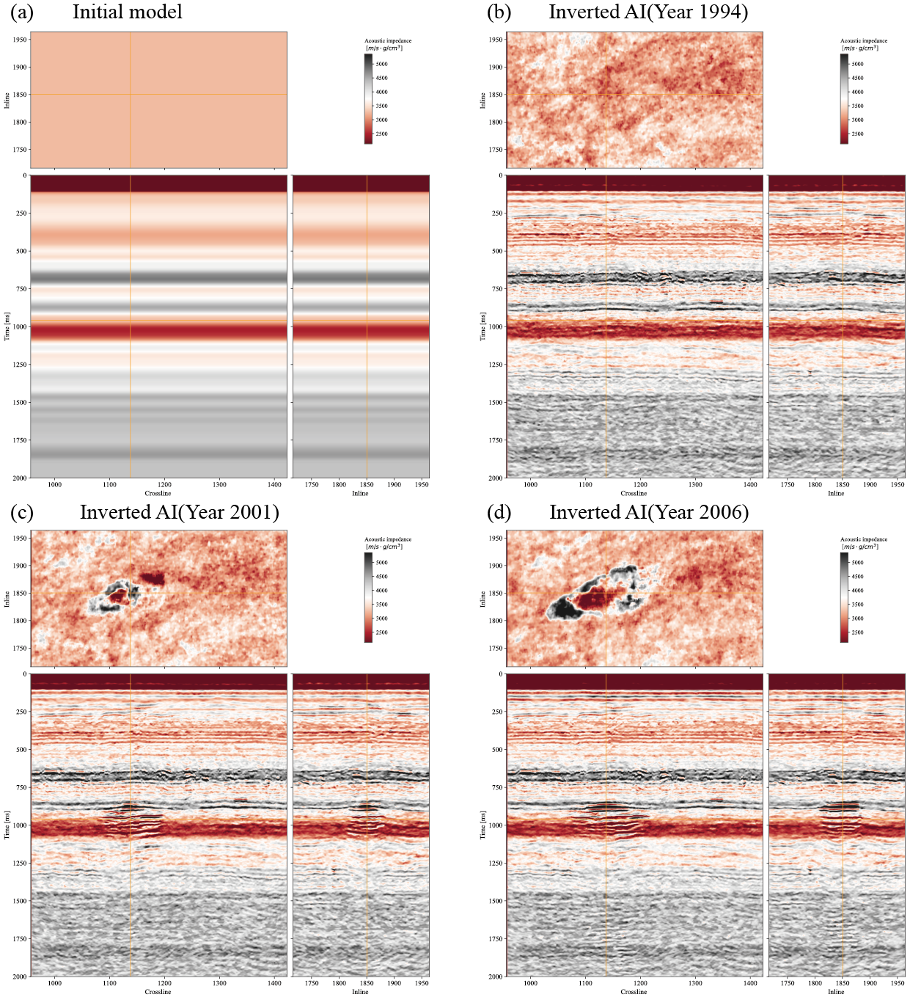

Reproducible material for Time-lapse seismic inversion using a 3D neural operator - Xiao Ma, Tariq Alkhalifah


# Project structure

This repository is organized as follows:

- :open_file_folder: **Time-lapse-inversion**: Python package containing the 3D neural-operator model, training driver, and the patch-based inversion scripts used for the Sleipner time-lapse experiments. Its contents are:
  - :page_facing_up: `__init__.py`: package marker so the directory is importable as a Python module.
  - :page_facing_up: `net_test.py`: definition of `UNO3D_cai`, the 3D Hierarchical Neural Operator (HNO) built on Fourier spectral convolutions, used as both the forward surrogate and the differentiable engine for inversion.
  - :page_facing_up: `patch_blend_utils.py`: helper routines for building tapered weight windows (Hann, Hamming, Gaussian, flat) and for accumulating and finalizing overlapping 3D patches when stitching a full volume.
  - :page_facing_up: `train_HNO_inversion_multi_gpu.py`: PyTorch Lightning training script for the 3D neural operator on synthetic seismic / acoustic-impedance pairs, with multi-GPU support.
  - :page_facing_up: `train_HNO_inversion_multi_gpu.sh`: launcher shell script that calls the training driver with the paths and hyperparameters used in the paper.
  - :page_facing_up: `Sleipner_inversion_full_scale_weight_patch.py`: multi-GPU (`torchrun`) patch-based inversion driver that runs the trained HNO on a full Sleipner SEGY cube and assembles the impedance volume from weighted patches.
  - :page_facing_up: `Sleipner_inversion_full_scale_weight_patch.sh`: launcher shell script for the full-scale inversion above.
  - :page_facing_up: `Sleipner_inversion_1994_weight_patch.py`: patch-based inversion configured for the 1994 Sleipner baseline survey.
  - :page_facing_up: `Sleipner_inversion_2001_weight_patch.py`: patch-based inversion configured for the 2001 Sleipner monitor survey.
  - :page_facing_up: `Sleipner_inversion_2004_weight_patch.py`: patch-based inversion configured for the 2004 Sleipner monitor survey.
  - :page_facing_up: `Sleipner_inversion_2006_weight_patch.py`: patch-based inversion configured for the 2006 Sleipner monitor survey.
- :open_file_folder: **asset**: folder containing the logo and figures used in the README.
- :open_file_folder: **data**: folder containing the data (or instructions on how to retrieve it). Specifically:
  - **Sleipner field data** can be downloaded from the CO2 DataShare portal at <https://co2datashare.org/dataset/sleipner-4d-seismic-dataset>.
  - **Synthetic training set** (`TRAIN_DATA_PATH`) used in the paper is stored at `/data/max0b/synthoseis_example/2025_11_23_3D_data_imp` (split into `train/` and `val/` sub-folders of seismic / impedance pairs).
  - **Pre-trained model checkpoint** used by the inversion notebooks and the `Sleipner_inversion_*` scripts is available at `/home/max0b/IP_inversion_NO/test_inversion1/test_inversion1-2025-12-07-15-41-25/checkpoints/epoch=22-step=20309.ckpt`.
- :open_file_folder: **notebooks**: set of Jupyter notebooks reproducing the experiments in the paper (see below for more details).
- :open_file_folder: **scripts**: set of auxiliary Python scripts used to launch additional experiments.

## Notebooks

The following notebooks are provided:

- :orange_book: `plot_HNO_inversion.ipynb`: end-to-end demonstration of the trained 3D Hierarchical Neural Operator. It loads a checkpoint of `UNO3D_cai`, evaluates the forward prediction on a synthetic validation sample, runs the differentiable impedance inversion on both the synthetic example and on a Sleipner SEGY survey, and produces the multi-slice impedance and seismic visualizations shown in the paper.

## Getting started :space_invader: :robot:

To ensure reproducibility of the results, we suggest using the `environment.yml` file when creating the environment.

The environment can be created in two equivalent ways.

**Option 1 — use the provided installer:**

```
./install_env.sh
```

It will take some time; if at the end you see the word `Done!` on your terminal you are ready to go.

**Option 2 — create the environment manually from `environment.yml`:**

```
conda env create -f environment.yml
conda activate opl2
```

The environment name (`opl2`) is defined inside `environment.yml`. Remember to always activate it before running any of the scripts or notebooks:

```
conda activate opl2
```

**Disclaimer:** All experiments have been carried out on a workstation equipped with **4 × NVIDIA A100 GPUs**. The training and full-scale Sleipner inversion scripts assume this multi-GPU setup (via `torchrun` / PyTorch Lightning DDP). Different environment configurations may be required for different combinations of workstation and GPU; in particular, the patch sizes and per-GPU batch sizes may need to be adjusted when running on hardware with less memory.

## Cite us

DW0123 - Xiao et al. (2026) Time-lapse seismic inversion using a 3D neural operator.
